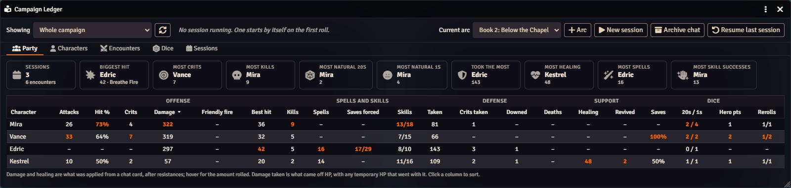
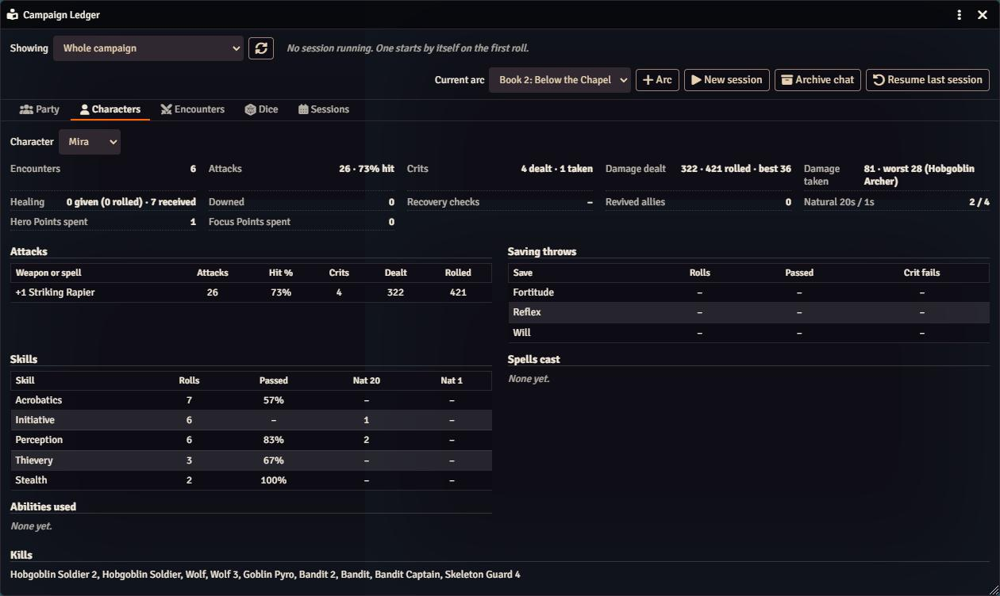
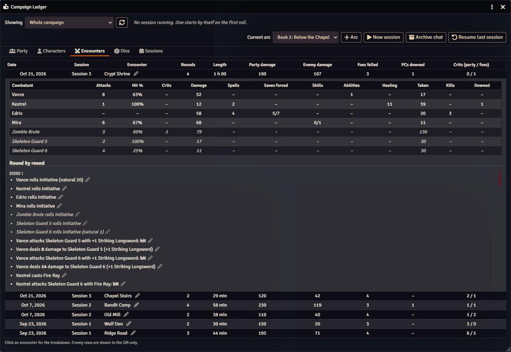
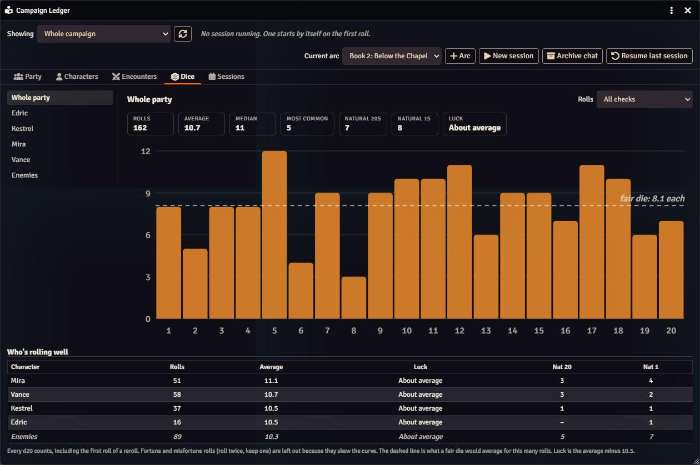
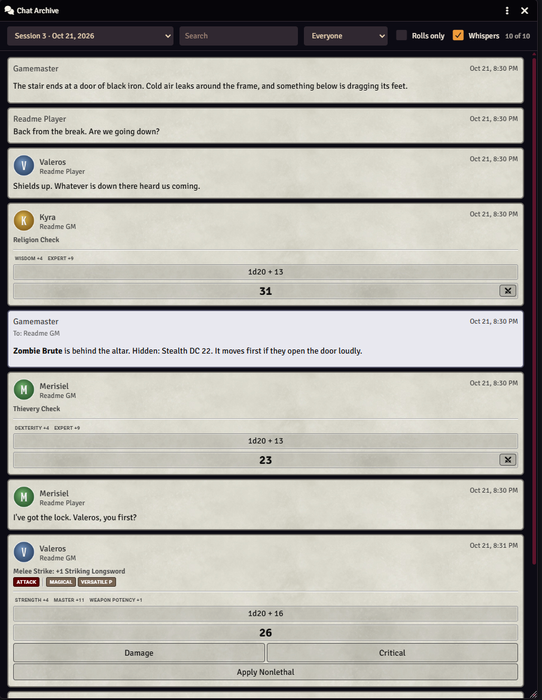
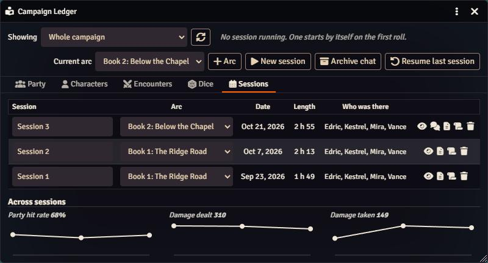

# PF2e Campaign Ledger

Long-term table statistics for Pathfinder 2e: attacks, crits, damage dealt and taken, healing, kills, downed and dying, saves, skills, spells, natural 20s and 1s, rerolls and Hero Points. Grouped by session, arc and encounter, viewed in a dashboard window, with reset, export and a read-only player view. Ending a session can archive the chat log with it and clear the chat, so long campaigns stay quick; the GM reads archived chat from the Sessions tab.

## What it looks like



**Party.** The whole campaign, one arc or one session at a glance: who leads in crits, kills, healing and natural 20s, then every character's offense, spells and skills, defense, support and dice. Click a column to sort. Players can open a read-only copy.



**Characters.** One character in depth: each weapon and spell with hit rate and damage, saves, skills, spells cast, abilities used, and what they felled.



**Encounters.** Every fight with its rounds, length and damage on each side. Open one for a per-combatant breakdown and a round-by-round log. Enemy rows are for the GM only.

<table>
<tr>
<td width="50%" valign="top"></td>
<td width="50%" valign="top"></td>
</tr>
<tr>
<td valign="top"><b>Dice.</b> How each character's d20 really rolls, next to what a fair die would do. It settles the "my dice hate me" argument.</td>
<td valign="top"><b>Chat archive.</b> End session saves the chat log with the session and clears it, so Foundry stays quick. Search, filter by speaker or rolls only. Whispers are the GM's; players read a copy without them or PF2e's GM-only details.</td>
</tr>
</table>



**Sessions.** Name sessions, group them into arcs, see who was there and how the party's numbers move from session to session, and export or import everything. The speech-bubble icon opens that session's archived chat; the page icon saves its numbers as Markdown.

## Install

In Foundry, go to **Add-on Modules**, then **Install Module**, and paste this into **Manifest URL**:

```
https://github.com/Sir-Bayard/pf2e-campaign-ledger/releases/latest/download/module.json
```

Foundry's **Update** button then picks up each new release. You can also download `module.zip` from the [latest release](https://github.com/Sir-Bayard/pf2e-campaign-ledger/releases/latest) and unzip it into `Data/modules/pf2e-campaign-ledger`.

Requires Foundry VTT 14 (verified on 14.370) and the Pathfinder 2e system 8.0.0 or later.

If you used PF2e Campaign Statistics, turn it off so rolls aren't recorded twice. Its journal can stay; the ledger doesn't read it.

Updating keeps your recorded data.

## What it does

Records table statistics as you play and shows them in a dashboard window: attacks, hit rate, crits dealt and taken, damage dealt and rolled, friendly fire, damage taken, healing, kills, downed, dying, deaths, recovery checks, saves, skills, spells cast, actions and feats used, natural 20s and 1s, rerolls and Hero Points spent. Everything is grouped by session, arc and encounter, and you can view the whole campaign, one arc or one session.

## Opening it

Token controls on the left: the book icon at the bottom of the list. Also in Game Settings, Configure Settings, PF2e Campaign Ledger. Macro: `game.modules.get("pf2e-campaign-ledger").api.open()`. The first time it opens on the running session (or the whole campaign when none is running); after that it keeps what you were looking at.

The ledger and the chat archive remember their size and place, per world and user, and work from the keyboard: Tab moves between controls, the arrow keys move between tabs, and once you've clicked in the ledger, Space and the arrow keys stay with it instead of pausing the game or moving the map. A click on the map gives the keys back.

## Tabs

- **Party**: Everyone side by side. Companions, familiars, summons and NPCs fighting on the party's side are in their own group under the characters, still counted with the party. A companion built as a character actor counts as a character. Click a column to sort.
- **Characters**: One character in detail: attacks by weapon, saves, skills, spells, abilities and kills.
- **Encounters**: Every combat. Open one for the per-combatant breakdown and a round-by-round log, which also shows damage and healing applied by hand. The GM can correct any line of the log (the pen): credit it to someone else, or delete it.
- **Dice**: Every d20 rolled, as a chart of how often each number came up, with average, median, most common, natural 20s and 1s, and luck.
- **Sessions**: Who was there (from the "At the table" ticks of a Bayard's Campaign Journal recap played that day, when there is one; otherwise the characters who did something), rename sessions, sort them into arcs, post a recap, save a session's numbers as Markdown, export, reset. With two sessions or more, small charts show the party's hit rate, damage dealt and taken and times downed, session by session.

## Sessions and arcs

A session starts by itself on the first roll, as long as a player is logged in (the GM's prep rolls don't start one; the "Start a session only when a player is logged in" setting turns that off). It's named "Session N"; rename it on the Sessions tab. "End session" closes it. "New session" starts the next one right away. "Resume last session" reopens the last one if it was ended too soon.

If nobody ends a session, it ends by itself when the next roll comes more than 10 hours after its last event (the "Hours between sessions" setting; 0 turns it off). Its recap is whispered to the GM, to repost if you like.

"+ Arc" adds an arc and makes it current. New sessions join the current arc.

## Chat archive

A long chat log slows Foundry down. "End session" offers to archive the chat with the session and clear it; "Archive chat" does the same at any time. Each message is filed with the session it was posted in. The speech bubbles on the Sessions tab open a session's archived chat, with search and filters. The GM's copy has every message, whispers included; the players' copy has only what everyone saw, with PF2e's GM-only parts taken out. The export button saves either copy as Markdown, to go beside a recap.

The GM's copy is kept out of the players' view, but like GM journals it isn't out of reach of a player who digs in the browser console: Foundry sends every journal and setting to every client, and whispered chat cards reach players' clients too. Treat whispers like GM journals.

Deleting a session can take its archived chat off the list too; otherwise it stays under "Deleted sessions" in the archive window. The files stay on the server either way. More in the [guide](docs/guide.md#chat-archive).

## Session recap

Ending a session posts a recap card: who was there, biggest hit, most damage, most crits, foes felled, who went down and who brought them back, friendly fire, healing, natural 20s and 1s, and Hero Points spent. With the author's other modules on, it adds a line each for quests revealed, objectives done and failed, and clues found (PF2e Campaign Trackers), money spent and earned at the market (PF2e Marketplace) and people met (PF2e NPC Attitudes). Only objectives the players can see count. The "Session recap" setting sends it to everyone, to the GM, or nowhere.

## Encounters

An encounter is recorded when combat begins in the tracker and closes when it ends. Rolls and damage during combat are tagged to it, with the round. Encounters are named after the scene's navigation name (the one players see); the GM can rename one with the pencil.

## Players

Players get a read-only view: party tables, characters, encounters, dice and sessions. Enemy rows, enemy lines in the round log and enemy dice are left out. Turn the player view off with the "Players can open the ledger" setting.

That keeps enemy numbers off the players' screens, not out of their reach: the session files (in `worlds/<world>/pf2e-campaign-ledger/`) hold every event, enemies included, and a player who digs in the browser can fetch them, even with the player view off.

## Reset, export and import

Sessions tab, GM only. "Export everything" downloads the whole ledger as JSON. "Reset ledger" downloads that export first, then clears everything. "Import" reads an export back in: what it holds is added, nothing is deleted.

## Pausing

Turn off "Record statistics" for test rolls or a one-shot. Nothing is recorded until you turn it back on.

## How it counts

- **Damage is damage dealt**: what came off HP and temporary HP when damage was applied from a chat card, after resistances, not counting overkill. The amount rolled is shown alongside it. Healing works the same way.
- **Friendly fire**: damage dealt to someone on your own side is counted apart, not as damage dealt. Damage a creature does to itself counts for nobody.
- Damage taken is what came off a character's HP, however it was applied, plus any temporary HP that went with the same hit. Temporary HP that runs out isn't damage, and HP that rises with the maximum isn't healing.
- Kills, downs and revives go to whoever applied the damage or healing. If HP was changed by hand, they go to whoever last hit (a hit, not a miss) or healed that creature in the past minute; failing that, to whoever's turn it is when they're on the other side (the same side, for healing); otherwise to nobody. Damage a creature does to itself, and persistent damage, goes to whoever put that damage on it (the damage roll, or the creature an effect that put it on came from), else to whoever last hit it in the past minute.
- The Revert button on a damage or healing card takes back everything recorded for that card, including a kill, down, revive, Dying or death it caused. When a player reverts a card someone else posted, their client tells the recording GM which card it was. PF2e leaves the Dying condition in place; remove it by hand if it shouldn't be there.
- A party member's death counts once: Dying reaching its maximum, or being marked dead.
- Natural 20s and 1s leave out initiative, which everyone rolls.
- Hit % and save % count only rolls with a known result. Saves rolled from PF2e Toolbelt's Target Helper are recorded, and a reroll there replaces the earlier result.
- Actions and feats count when their card is posted. The same character using the same ability within 5 seconds counts once.
- "Saves forced" credits a spell or ability's user with the saves it forced on the other side (failed / rolled). "Skills" is skill checks that succeeded / checks against a DC, initiative left out.
- **Dice**: every d20 counts, including the first roll of a reroll; fortune and misfortune rolls are left out of the Dice tab. Luck compares the average with a fair die's: "About average" within what chance explains for that many rolls, "Running hot" or "Running cold" beyond twice that, the difference in between.
- Enemies are recorded by token name, so give them names your players may see.
- Hero Points count as spent when one goes down and a reroll follows within 10 seconds (or all at once while dying). A reset by the GM or another module isn't counted.
- Only the GM's client records, and only one tab of it if the GM has the world open twice; when another tab takes over, what each recorded is kept. If no GM is logged in, nothing is recorded. Sessions save every 30 seconds and at the end of each round.

## Macros and API

A macro that posts its own chat message counts as an ability use with the flag `flags: { "pf2e-campaign-ledger": { ability: "<name>" } }`. The module's API (`open`, `sessions`, `stats`, `startSession`, `endSession` and more) is in the [guide](docs/guide.md#api).

## Where the data lives

One JSON file per session in `Data/worlds/<your world>/pf2e-campaign-ledger/`, one per chat archive beside them, and the list of sessions and arcs (with each ended session's totals for the Sessions tab) in a world setting. Back up the world folder and you've backed up the ledger.

## Translations

Every word the module shows is in `lang/en.json`. A translation is a copy of that file in another language, listed in `module.json`; none ships yet.

## Changes

See [CHANGELOG.md](CHANGELOG.md).

## How it was made

This module was written with Claude, Anthropic's AI assistant, directed and tested by its author at a real table. It is shared as is, for free.

## Problems and suggestions

Open an [issue](https://github.com/Sir-Bayard/pf2e-campaign-ledger/issues).

## License

[MIT](LICENSE). Copyright (c) 2026 Sir Bayard.

## Pathfinder

PF2e Campaign Ledger is an unofficial, free module for the Pathfinder Second Edition system on Foundry VTT. It is not published, endorsed or specifically approved by Paizo Inc. Pathfinder is a trademark of Paizo Inc., used here only to say which game the module works with. The module follows the game's rules, which Paizo publishes under the ORC License, and refers to them by name; it doesn't reproduce Paizo's rules text, art or setting material.
