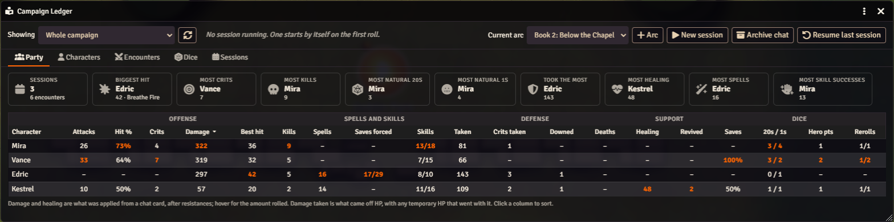
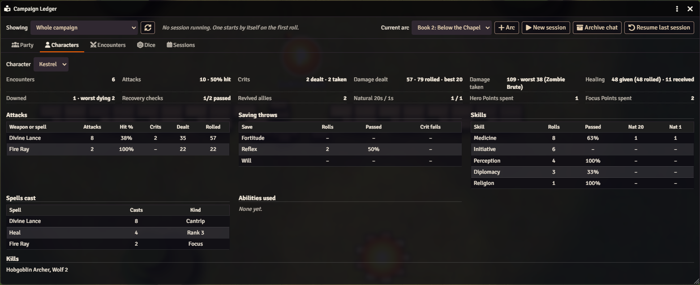
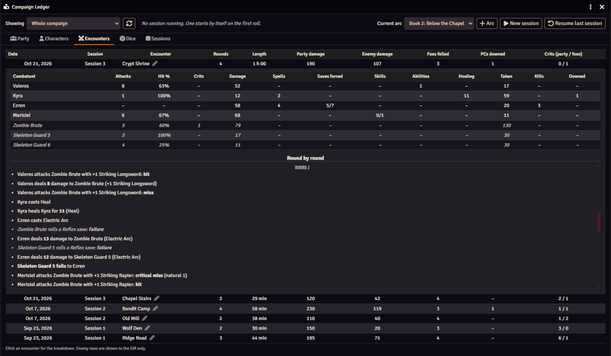
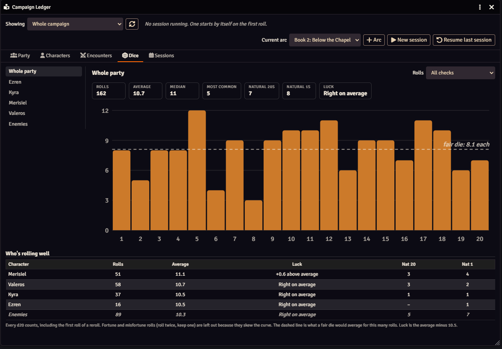
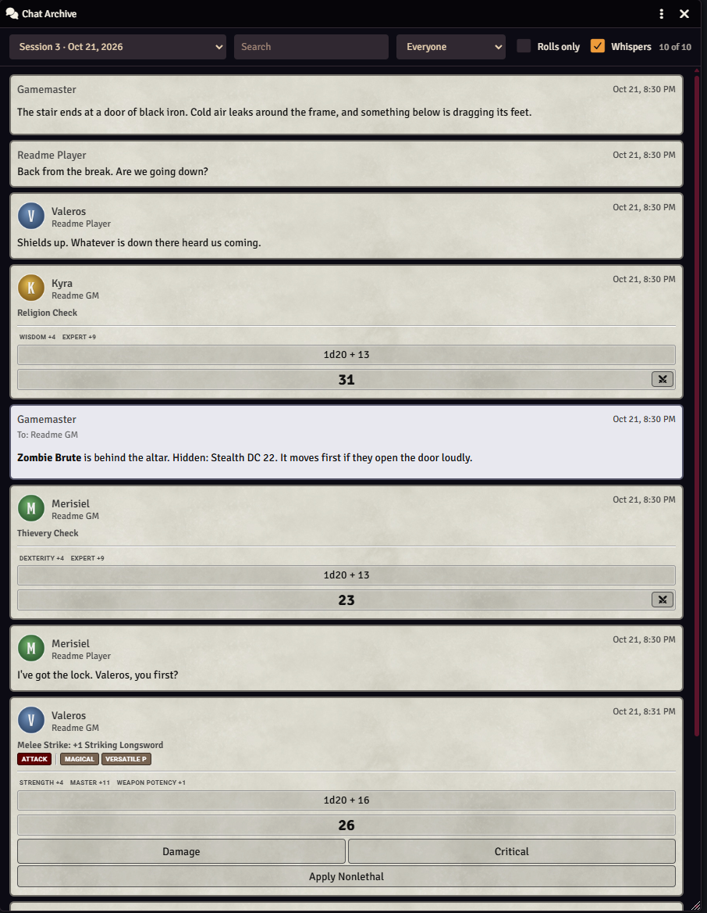
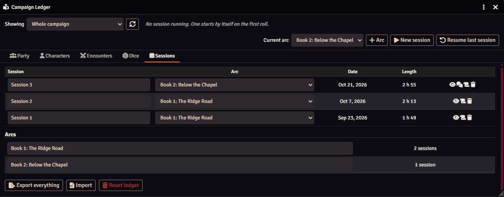

# PF2e Campaign Ledger

Long-term table statistics for Pathfinder 2e: attacks, crits, damage dealt and taken, healing, kills, downed and dying, saves, skills, spells, natural 20s and 1s, rerolls and Hero Points. Grouped by session, arc and encounter, viewed in a dashboard window, with reset, export and a read-only player view. Ending a session can archive the chat log with it and clear the chat, so long campaigns stay quick; the GM reads archived chat from the Sessions tab.

## What it looks like



**Party.** The whole campaign, one arc or one session at a glance: who leads in crits, kills, healing and natural 20s, then every character's offense, spells and skills, defense, support and dice. Click a column to sort. Players can open a read-only copy.



**Characters.** One character in depth: each weapon and spell with hit rate and damage, saves, skills, spells cast, abilities used, and what they felled.



**Encounters.** Every fight with its rounds, length and damage on each side. Open one for a per-combatant breakdown and a round-by-round log. Enemy rows are for the GM only.

<table>
<tr>
<td width="50%" valign="top"></td>
<td width="50%" valign="top"></td>
</tr>
<tr>
<td valign="top"><b>Dice.</b> How each character's d20 really rolls, next to what a fair die would do. It settles the "my dice hate me" argument.</td>
<td valign="top"><b>Chat archive.</b> End session saves the chat log with the session and clears it, so Foundry stays quick. Search, filter by speaker or rolls only. Whispers are the GM's; players read a copy without them or PF2e's GM-only details.</td>
</tr>
</table>



**Sessions.** Name sessions, group them into arcs, and export or import everything. The speech-bubble icon opens that session's archived chat.

## Install

In Foundry, go to **Add-on Modules**, then **Install Module**, and paste this into **Manifest URL**:

```
https://github.com/Sir-Bayard/pf2e-campaign-ledger/releases/latest/download/module.json
```

Foundry's **Update** button then picks up each new release. You can also download `module.zip` from the [latest release](https://github.com/Sir-Bayard/pf2e-campaign-ledger/releases/latest) and unzip it into `Data/modules/pf2e-campaign-ledger`.

Requires Foundry VTT 14 (verified on 14.369) and the Pathfinder 2e system 8.0.0 or later.

If you used PF2e Campaign Statistics, turn it off so rolls aren't recorded twice. Its journal can stay; the ledger doesn't read it.

Updating keeps your recorded data.

## What it does

Records table statistics as you play and shows them in a dashboard window: attacks, hit rate, crits dealt and taken, damage dealt and rolled, damage taken, healing, kills, downed, dying, deaths, recovery checks, saves, skills, spells cast, actions and feats used, natural 20s and 1s, rerolls and Hero Points spent. Everything is grouped by session, arc and encounter, and you can view the whole campaign, one arc or one session.

## Opening it

Token controls on the left: the book icon at the bottom of the list. Also under Game Settings &gt; Configure Settings &gt; PF2e Campaign Ledger. Macro: `game.modules.get("pf2e-campaign-ledger").api.open()`

## Tabs

- **Party**: Everyone side by side. Click a column to sort.
- **Characters**: One character in detail: attacks by weapon, saves, skills, spells, abilities and kills.
- **Encounters**: Every combat. Click one for the per-combatant breakdown (attacks, damage, spells, saves forced, skills, abilities, healing, damage taken, kills, downs) and a round-by-round log.
- **Dice**: Every d20 rolled, as a chart of how often each number came up, with average, median, most common, natural 20s and 1s, and luck. Pick a character on the left and a kind of check at the top.
- **Sessions**: Rename sessions, sort them into arcs, post a recap, export, reset.

## Sessions and arcs

A session starts by itself on the first roll and is named "Session N". Rename it on the Sessions tab. "End session" closes it; the next roll starts a new one. "New session" ends the current one and starts the next right away. "Resume last session" reopens the most recently ended session if it was ended too soon.

If nobody ends a session, it ends by itself: when the next roll comes more than 10 hours after the session's last event (the "Hours between sessions" setting; 0 turns it off), the old session is closed as of that last event, a new one starts, and the GM gets a whisper saying so.

When a session starts recording, the GM gets a whisper in chat saying which session, its arc and the time (the "Whisper when recording starts" setting turns it off).

"+ Arc" adds an arc and makes it current. New sessions join the current arc. You can move any session to a different arc from the Sessions tab.

## Chat archive

A long chat log slows Foundry down. "End session" offers to archive the chat with the session and clear it (the box is ticked; the "Offer to archive the chat at End session" setting turns the offer off). "Archive chat" at the top of the ledger does the same at any time, into the running session (or the latest one). Each message is filed with the session it was posted in: a recap or a whisper left over from the last session goes with that session, not the new one. Only the active GM archives. Every message is saved as it looked in chat, the files are read back to check them, and only then are those messages deleted; anything posted meanwhile stays. The recap is posted after the chat is cleared.

The speech bubbles on the Sessions tab open a session's archived chat: search, a speaker filter, rolls only, and for the GM whispers on or off. Each archive is two files. The GM's copy has every message, whispers and blind rolls included, with what the GM saw (DCs, modifiers). The players' copy has only the messages everyone saw, as the players saw them: PF2e's GM-only parts (DCs, modifiers, roll formulas) are taken out, and a speaker whose name the players couldn't see shows as "Unknown". Players read their copy when they can open the ledger and "Players can read the archived chat" is on.

The GM's copy is kept out of the players' view (a random file name, listed on a GM-only journal entry, "Campaign Ledger (GM data)"; don't delete it), but like GM journals and stat blocks it isn't out of reach of a player who digs in the browser console. Foundry sends every journal, compendium and setting to every client; chat whispers are the only thing the server itself withholds.

If that journal entry is ever deleted, `game.modules.get("pf2e-campaign-ledger").api.rebuildChatIndex()` lists the archive files again. If the players' list loses an archive (after an Import, say), it is put back the next time the GM loads the world.

## Session recap

Ending a session posts a recap card to chat: biggest hit, most damage, most crits, foes felled, who went down and who brought them back, healing, natural 20s and 1s, and Hero Points spent. The "Session recap" setting chooses whether it goes to everyone, is whispered to the GM, or isn't posted. The scroll icon on the Sessions tab posts a recap for any session.

## Encounters

An encounter is recorded when you begin combat in the tracker and closes when you end it. Rolls and damage during combat are tagged to it, with the round. Encounters are named after the scene's navigation name (the one players see). The GM can rename one with the pencil next to its name on the Encounters tab.

## Players

Players get a read-only view: party tables, characters, encounters, dice and sessions. Enemy rows, enemy lines in the round log and enemy dice are GM-only. Turn the player view off with the "Players can open the ledger" setting.

## Reset, export and import

Sessions tab (and the window's header menu), GM only. "Export everything" downloads a JSON file of the whole ledger. "Reset ledger" downloads that export first, then clears everything. The trash icon deletes a single session. "Import" reads an export back in: sessions and arcs it holds are added, ones already in the ledger get any events they are missing, and nothing is deleted. Deleting a session or resetting leaves the session files on disk; they are safe to remove by hand.

## Pausing

Turn off "Record statistics" in the module settings for test rolls or a one-shot. Nothing is recorded until you turn it back on.

## How it counts

- **Damage is damage dealt**: what came off HP and temporary HP when damage was applied from a chat card, after resistances, not counting overkill. The amount rolled is shown alongside it. Healing works the same way.
- Damage taken is what actually came off a character's HP, however it was applied, plus any temporary HP that went with the same hit. Temporary HP cleared on its own isn't damage, and HP that rises together with the maximum (a level, a rest that raised it) isn't healing.
- Kills, downs and revives are credited to whoever applied the damage or healing. If HP was changed by hand, they go to whoever last hit (a hit, not a miss) or healed that creature in the past minute; failing that, to the creature whose turn it is when it's on the other side (the same side, for healing). Otherwise they're left unattributed.
- The Revert button on a damage or healing card takes back everything recorded for that card, including a kill, down or revive it caused, and the undo isn't counted as healing or damage. Use it from the GM's client or the client of whoever applied the damage: Foundry doesn't let anyone else change the card, so the ledger never hears of the revert. Dying and deaths stay as PF2e leaves them; remove the condition by hand if it shouldn't be there.
- Hit % and save % only count rolls with a known result. A strike with no target, or a save with no DC, still counts as a roll but not toward the percentage.
- Saves rolled from PF2e Toolbelt's Target Helper (the save bar on spell and damage cards) are recorded, and a reroll there replaces the earlier result.
- Actions and feats count when their card is posted to chat. The same character using the same ability within 5 seconds counts once.
- Spells, skills and abilities count as contributions alongside attacks. "Saves forced" credits a spell or ability's user with the saves it forced on the other side, shown as failed / rolled. This works for saves rolled from a spell or damage card, including Target Helper; a save rolled from the sheet with no card doesn't say who forced it. "Skills" is skill checks that succeeded / skill checks against a DC, with initiative left out. Sessions before 0.3.2 have no saves forced.
- **Dice**: every d20 counts, including the first roll of a reroll. Fortune and misfortune rolls (roll twice, keep one) are left out of the Dice tab because they skew the curve. Luck is the average roll minus 10.5.
- Enemies are recorded by token name, so give them names your players are allowed to see. When no token can be found, the prototype token's name is used; the actor's own name never is. NPCs whose alliance is "party" (hirelings, allies) count on the party's side.
- Hero Points count as spent when one goes down and a reroll follows within 10 seconds (or all at once while dying, to stabilise). Any other decrease, such as a reset by the GM or by Workbench's Hero Point Handler, is kept as lost and not counted.
- Only the GM's client records. If no GM is logged in, nothing is recorded.
- Sessions recorded before 0.3.0 have no damage dealt, since that wasn't recorded yet. Their rolled damage is still there.

## Macros

A macro that posts its own chat message can count as an ability use by adding this flag to the message:

```
flags: { "pf2e-campaign-ledger": { ability: "Keep Them Breathing" } }
```

The flag can also be set afterward with

```
message.setFlag("pf2e-campaign-ledger", "ability", "Vicious Swing")
```

## Where the data lives

One JSON file per session in `Data/worlds/<your world>/pf2e-campaign-ledger/`, and one per chat archive (`chat-<random>.json`) beside them.

The list of sessions and arcs is a world setting. Back up the world folder and you've backed up the ledger.

## Changes

See [CHANGELOG.md](CHANGELOG.md).

## How it was made

This module was written with Claude, Anthropic's AI assistant, directed and tested by its author at a real table. It is shared as is, for free.

## Problems and suggestions

Open an [issue](https://github.com/Sir-Bayard/pf2e-campaign-ledger/issues).

## License

[MIT](LICENSE). Copyright (c) 2026 Sir Bayard.

## Pathfinder

PF2e Campaign Ledger is an unofficial, free module for the Pathfinder Second Edition system on Foundry VTT. It is not published, endorsed or specifically approved by Paizo Inc. Pathfinder is a trademark of Paizo Inc., used here only to say which game the module works with. The module follows the game's rules, which Paizo publishes under the ORC License, and refers to them by name; it doesn't reproduce Paizo's rules text, art or setting material.
